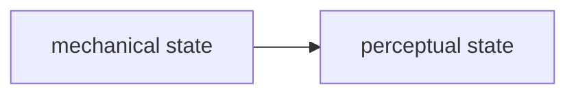

# Artificial Emotion — Content Authoring Guide

Canonical editorial reference for authoring this research notebook in Obsidian.
The same Markdown is rendered by the public Astro site.

Copy a template from this folder into the matching collection, rename the file
to a kebab-case slug, and fill in the properties. Files and folders whose names
start with `_` are never loaded by Astro.

Schema source of truth: `Site/src/content.config.ts` and `Site/src/lib/vocabulary.ts`.

## Core principle

Markdown is the source of truth.

Content lives in Markdown.
Components own interface and rendering behaviour.

Prefer standard Markdown that works in Obsidian whenever possible.

Custom syntax should only be used when Obsidian has no native equivalent,
such as the project-specific `::model` and `::lab` embeds.

## Collection decision guide

**Use a Study when** you made or tested something inside the research: an
experiment, mechanism, prototype, material test, or process record.

**Use a Studio Note when** the entry is context: a person, institution, tool,
software, material, place, method, observation, collaboration, or
infrastructure.

**Use a Reference when** the entry is an external source that informed the
research.

**Use an Event when** the entry documents a public moment.

**Use a Research Thread when** the file defines one of the project’s major
conceptual research directions. There are only three, and the filename must
be the canonical id.

A Research Thread is not a Study, Note, Reference, or Event.

## How to create an entry

1. Copy the matching template into `studies/`, `notes/`, `references/`,
   `events/`, or `research/`.
2. For Studies, Notes, References and Events, set `slug` to the public
   identifier (lowercase kebab-case) and name the file
   `YYYY-MM-DD-slug.md` using the entry `date`. The slug is the URL;
   do not change it after publishing. Research Thread filenames stay the
   canonical thread id.
3. Fill the remaining frontmatter in Obsidian’s Properties panel.
4. Write the body as narrative Markdown.
5. Keep `draft: true` until the entry should be public. Set `draft: false`
   to publish.

## Collections

### Study

An experiment, prototype, or process record created inside the research.

The collection already defines the entry as a Study. Do **not** add `type`.

`status` is required. Leave it empty in the template and choose one:

| Status | Meaning |
| ------ | ------- |
| `seed` | Early question, direction, or initial study; still very exploratory |
| `experiment` | Active test of a behaviour, mechanism, material, or relationship |
| `prototype` | Working physical or computational artifact that demonstrates a usable mechanism or system |
| `integrated` | Incorporated into a larger work, installation, or stable system |

Default body convention (not validated; a more narrative structure is allowed):

```md
## Question
## Setup
## Observation
## Next
```

Template: `study-template.md`

### Studio Note

A generic knowledge object that is not a Study, Reference, or Event.

`type` is a lightweight semantic hint, not a closed vocabulary. The schema
accepts any string. Examples in kebab-case: `person`, `institution`,
`software`, `project-origin`, `store-resource`, `infrastructure`,
`information-architecture`, `observation`. New values may appear without
a code change.

Notes have no required body structure.

Template: `note-template.md`

### Reference

An external source that informed the research (artist, artwork, book,
article, exhibition, project, website, video, or an institution used
specifically as a source).

A Reference is not a Studio Note.

- `date` = when this entry entered the Artificial Emotion notebook
- `year` = chronology of the referenced work
- `referenceType` = type of external source (`artwork`, `artist`, `book`, …)

Prefer `cover` for the primary image. The schema still accepts a legacy
`image` field; do not add it to new entries.

Default body convention (editorial, not validated): `## Why it matters` /
`## Notes`.

Template: `reference-template.md`

### Event

A public moment in the research (open studio, workshop, exhibition, talk,
presentation, screening, residency).

- `eventType` = semantic category: `open-studio`, `workshop`, `exhibition`,
  `talk`, `presentation`, `screening`, `residency`, `other`
- `status` = lifecycle: `upcoming`, `ongoing`, `past`, `cancelled`
- `date` = calendar date of the event
- `timezone` defaults to `Europe/Zurich`; keep it explicit in the file
- Quote clock times (`startTime: "14:00"`) so YAML does not treat `14:00` as
  a number

Default body convention. Empty headings are not rendered:

```md
## About
## Program
## Documentation
## Reflection
```

Template: `event-template.md`

### Research Thread

A conceptual layer above the four primary collections. Editorial Markdown
describes the research direction. Filename **is** the canonical id:

- `soft-mechanisms.md`
- `kinetic-studies.md`
- `heartbeat-biosignals.md`

Do not add `threads`, `related`, `type`, or `status` to a Research Thread.

Membership is declared on Studies, Notes, References, and Events:

```yaml
threads:
  - kinetic-studies
```

Do not list those entries inside the Research Thread file.

`galleryFolder` is Research Threads only (Cloudinary folder listing at build
time). Other collections use a manual `gallery`.

Template: `research-template.md`

## Field semantics

### date

Every authored Markdown entry has a date. Meaning depends on collection:

| Collection | Meaning of `date` |
| ---------- | ----------------- |
| Study / Note | Notebook / research date |
| Reference | Date added to the notebook |
| Event | Calendar date of the event |
| Research Thread | Date the thread entry was authored |

Reference chronology of the work itself stays in `year`, not `date`.

### slug

Studies, Notes, References and Events: the public URL identity.

`content/studies/2026-10-15-paper-heart.md` with `slug: paper-heart`
→ `/studies/paper-heart/`.

Do not derive `slug` from `title`. Do not change it after the entry is
public. `related` targets use this slug: `studies/paper-heart`.

Research Threads have no `slug`; the filename is the canonical thread id.

### status

Only lifecycle / state. Do not confuse with content type.

- Study: `seed` · `experiment` · `prototype` · `integrated` (required)
- Event: `upcoming` · `ongoing` · `past` · `cancelled`

### type

Only where semantically useful.

- Notes use `type`
- Studies do **not**
- References use `referenceType`
- Events use `eventType`

### threads

Membership in one or more canonical Research Threads:
`soft-mechanisms`, `kinetic-studies`, `heartbeat-biosignals`.

### tags

Shared characteristics / facets used for discovery across the archive.

A tag answers: “Why would I want to find other entries sharing this
characteristic?”

Examples: `cardboard`, `pla`, `acrylic`, `3d-printing`, `grasshopper`,
`kinetic-mechanisms`, `folding`, `wetzikon`.

Physical substances that are useful for finding other work belong here.
Detailed parts lists, dimensions, and fabrication specifications belong
in the Study body (Setup / Fabrication), not in a separate frontmatter
field.

Tags are **not** explicit relationships.

### related

A strong artist-declared relationship, written as `collection/slug`:

```yaml
related:
  - studies/two-hours-to-a-first-kinetic-prototype
  - notes/raven
```

Valid collections: `studies`, `notes`, `references`, `events`.
Research Threads are not `related` targets. The target does not have to
exist yet.

Examples: this prototype developed from another study; this note documents
the institution connected to this work; this reference informed this
experiment.

Shared tag ≠ related.

### gallery

Ordered media sequence. Preferred authoring format is the explicit object:

```yaml
gallery:
  - type: image
    src: https://res.cloudinary.com/example/image/upload/studio.webp
    alt: Description of the image
    caption: Optional caption
  - type: video
    src: https://res.cloudinary.com/example/video/upload/test.mp4
    poster: https://res.cloudinary.com/example/image/upload/test-poster.webp
    caption: Optional caption
```

A bare image URL or site-root path is technically accepted and treated as an
image with empty alt text. Prefer the object form so alt text, media type,
captions, and poster metadata are preserved.

Remote values must be `https://` URLs. Local values start with `/`.

### cover

Primary visual used in listings and article presentation. Same media rules
as gallery sources: HTTPS URL or site-root path.

### draft

- `true` = private / unpublished (schema default)
- `false` = public

## Related vs tags vs threads

| Field | Means |
| ----- | ----- |
| `threads` | Conceptual research membership |
| `tags` | Shared characteristics |
| `related` | Explicit intentional connection |

Do not infer `related` links from tags.

## Markdown / embed rules

### Standard Markdown first

Prefer:

- Markdown links
- Markdown images
- tables
- blockquotes
- Mermaid fenced blocks
- ordinary iframe HTML when an embed is needed and allowed
- ordinary video HTML when a hosted HTTPS file is needed

### Mermaid

Use a standard fenced block. This works in Obsidian and on the site:

````md

````

Do not use project-specific Mermaid syntax.

### iframe

Ordinary iframe HTML is allowed through the site’s controlled sanitizer.
Use HTTPS sources only.

```html
<iframe
  src="https://www.youtube.com/embed/VIDEO_ID"
  title="Descriptive title"
  width="640"
  height="360"
  allowfullscreen
></iframe>
```

Some remote providers may refuse embedding even if the iframe works in
Obsidian.

### video

Ordinary `<video>` HTML is allowed through the site’s controlled sanitizer.
Use a complete `<video …></video>` block and an HTTPS `src` only.
Inline `style` may be kept for Obsidian; the site drops it and sizes the
video with CSS.

```html
<video
  src="https://res.cloudinary.com/example/video/upload/clip.mp4"
  autoplay
  muted
  loop
  playsinline
  preload="metadata"
  style="width: 100%; height: auto;"
></video>
```

Allowed attributes: `src`, `controls`, `autoplay`, `muted`, `loop`,
`playsinline`, `preload`, `poster`, `width`, `height`, `aria-label`.
If `autoplay` is present, the site also requires `muted` and `playsinline`.

### Project-specific directives

Keep these because Obsidian has no native equivalent:

```md
::model{src="kinetic-module-maumau/spool.stl" title="MauMau Spool" caption="Optional caption"}
```

`src` is a repository-relative STL or GLB path. Do not move the file into `Site/`.

```md
::lab{src="/lab/heartbeat-slit-animation/" title="Heartbeat Slit Animation Lab"}
```

`src` must be a same-origin lab route under `/lab/`.

`::youtube{src title}` still works as a compatibility alias. Prefer an
ordinary HTTPS iframe instead.

## Naming / style

- Filenames: `YYYY-MM-DD-slug.md` for Studies, Notes, References and
  Events. Research Threads keep the canonical thread id.
- Tags: lowercase kebab-case
- Thread ids: canonical ids only
- Titles: editorial, human-readable
- No redundant “Artificial Emotion” tag
- No collection name as a tag (`study`, `note`, …)
- Do not add properties just because databases commonly have them

Properties must earn their place.

## Obsidian compatibility

The same Markdown should remain useful inside Obsidian and on the public
site.

- Avoid Astro-only authoring syntax when a standard Markdown or HTML
  equivalent already works
- Keep content portable
- Rendering enhancements belong in Astro where possible
- Empty YAML properties (`cover:`) count as “not set”
- Obsidian may write a cleared select as `key:` or `""`; the schema treats
  both as unset
