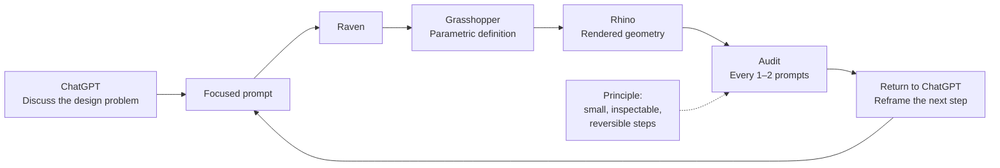

## Encountering Raven

I first encountered **Raven** during **EXTRAFACES — AI & Design Lab**, a workshop held during Zurich Design Weeks 2026.

The workshop took place at Dynamo in Zurich over 19–20 September and explored AI-assisted design, parametric geometry and digital fabrication through Rhino, Grasshopper and Raven.

That is where I met **Maximilian Rietschel**, one of Raven's co-founders.

Raven V2 was being introduced around that moment, and the team gave me a subscription so I could continue testing it after the workshop. I have since kept using it while developing parts of **Artificial Emotion**.

Many thanks to Max and the Raven team for making that possible.

## Why it caught my attention

I have been interested in **Grasshopper** for around fifteen years.

My own projects have often crossed paths with designers and architects who work parametrically, and I have always found the underlying idea of parametric design compelling: rather than drawing only a final object, you describe relationships, rules and variables that can generate many possible versions of it.

Raven adds a natural-language layer to that environment.

The company describes it as an “intelligence layer for CAD”: a system that can turn an instruction, sketch or intention into editable geometry and Grasshopper definitions inside Rhino.

For me, the interesting part is not replacing Grasshopper.

It is being able to converse with a parametric system while the logic remains visible and editable.

## How I currently use it

My preferred workflow is still **Raven + Grasshopper + Rhino**.

Raven can now work more directly inside Rhino, but I still feel more comfortable asking it to build and modify Grasshopper definitions and letting Grasshopper drive the geometry in Rhino.

Part of that preference is simply familiarity.

Grasshopper gives me a visible computational structure. I can inspect the definition, see the parameters, follow relationships between components and intervene manually when necessary.

That visibility matters when using an LLM-based system.

## A conversational workflow

After using Raven intensively for about a month, I have developed a workflow that currently feels much more reliable than asking one AI system to carry an entire CAD problem by itself.

The sequence is usually:

1. I discuss the design or fabrication problem with **ChatGPT**.
2. We clarify the mechanical question and prepare a focused prompt.
3. I send that prompt to **Raven**.
4. Raven builds or changes the Grasshopper definition.
5. After roughly one or two prompts, I stop and ask Raven to **audit what it has done**.
6. I inspect the Grasshopper definition and the resulting geometry.
7. I bring the decisions, problems or uncertainties back into ChatGPT.
8. We reformulate the next step and repeat.

This creates a loop between conversation, generation and inspection rather than a long sequence of unattended AI decisions.

For the way I work, the audit step is essential.

Without it, I find that an AI CAD workflow can start making assumptions too quickly, jumping to conclusions or accumulating decisions that were never explicitly discussed.

I do not necessarily need the largest or most capable language model at every step.

What matters more is keeping the process **small, inspectable and reversible**.

This is only my current method, in late 2026. Raven and the underlying models are changing quickly, so this workflow may change with them.

## Parametric design as a working language

What I like about using Raven with Grasshopper is that the result does not have to remain trapped inside the conversation.

The useful output is a parametric definition.

That means dimensions can remain adjustable, fabrication constraints can be exposed as parameters, and an object can continue to evolve without being rebuilt from scratch every time a value changes.

This has been particularly useful in **Artificial Emotion**, where many physical studies depend on relationships between motors, spools, enclosures, fixation systems, clearances and fabrication methods.

The geometry is not only a representation of the object.

It becomes part of the way the object is thought through.

## Raven in action

Raven's own demo shows the system moving from a sketch toward editable CAD geometry.

<iframe
  width="100%"
  height="400"
  src="https://www.youtube.com/embed/oWfrKzJ3wk8"
  title="Raven demo — From sketch to CAD"
  frameborder="0"
  allow="accelerometer; autoplay; clipboard-write; encrypted-media; gyroscope; picture-in-picture"
  allowfullscreen>
</iframe>

## About Raven

[Raven](https://www.raven.build/en) is developed by **Raven CAD GmbH** in Zurich.

It works inside **Rhino 8 and Grasshopper**, using natural-language interaction to inspect and edit geometry, build Grasshopper definitions, create scripts and work with existing plugins.

Its relationship to Grasshopper is particularly interesting to me because it does not require parametric design to disappear behind an opaque interface. The definition can remain part of the working material.

For Artificial Emotion, that makes Raven less interesting as a system that “designs for me” and more interesting as a way of accelerating a design language I already value.

## Context

I encountered Raven through **EXTRAFACES — AI & Design Lab** during Zurich Design Weeks 2026.

The workshop brought together Rhino, Grasshopper, Raven and digital fabrication to design flat components within a shared interlocking system and fabricate them physically.

That encounter became the beginning of my ongoing use of Raven in this research.

[Raven](https://www.raven.build/en)

[Raven Press Kit](https://www.raven.build/en/press-kit)

[EXTRAFACES — event information](https://partiful.com/e/joPnj8ACp8O2wyKEmgzf)
